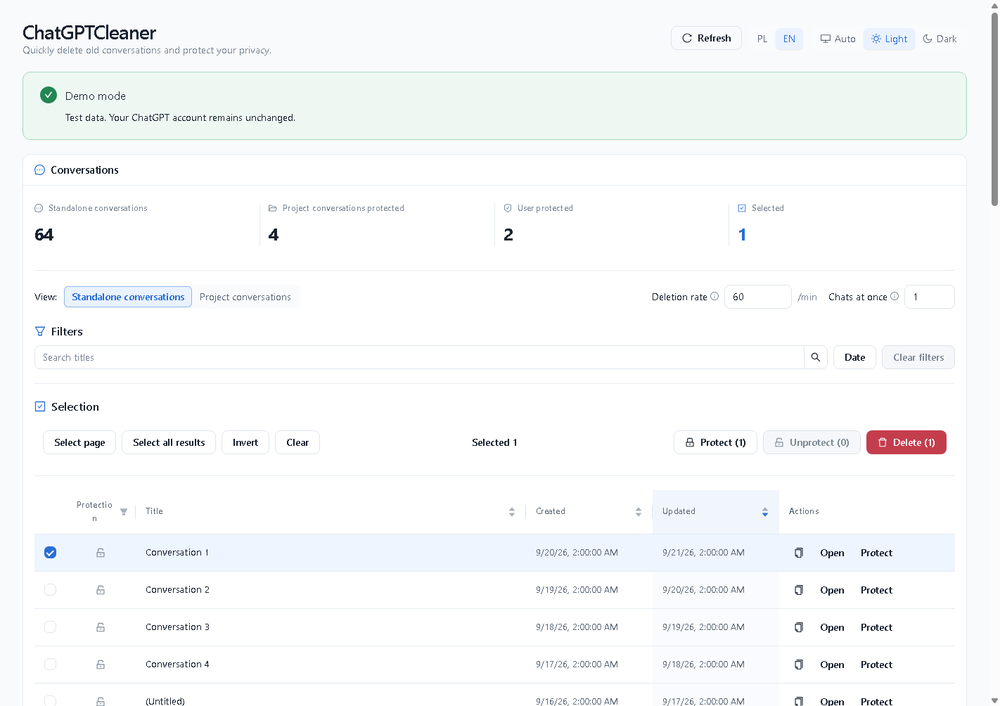
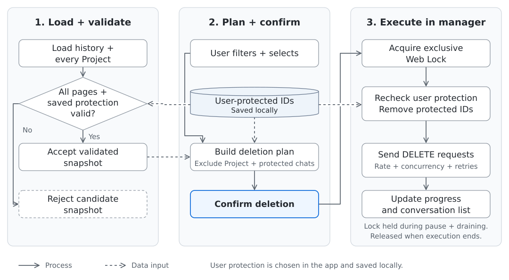

# ChatGPTCleaner

An unofficial Chrome extension for reviewing and bulk-deleting selected ChatGPT
conversations.



## Features

- Filter, sort, and select conversations in a paginated table.
- View Project conversations separately; they are excluded from deletion.
- Protect conversations locally to exclude them from deletion.
- Adjust deletion rate and the maximum number of chats handled at once, with progress,
  retries, and Pause, Resume, and Stop controls.

## Installation

Requires Chrome 120 or newer.

1. Download `ChatGPTCleaner-vX.Y.Z-chrome.zip` from
   [GitHub Releases](https://github.com/BinaryWorlds/ChatGPTCleaner/releases/latest).
2. Extract it to a permanent directory.
3. Open `chrome://extensions` and enable **Developer mode**.
4. Click **Load unpacked** and select the directory containing `manifest.json`.

Keep this directory available: Chrome loads the extension from it.

## Usage

1. Open `https://chatgpt.com`, sign in, and keep that tab open.
2. With the ChatGPT tab active, click the ChatGPTCleaner toolbar button.
3. Wait for conversation and Project loading to finish.
4. Protect any conversations you want to keep, then filter and select conversations.
5. Review the eligible deletion count and confirm deletion.

**Deletion rate** controls how often operations start, including retries.
**Chats at once** limits how many operations can be in progress. Operations start
according to the rate setting; slow responses can reduce the overall pace.

### Before deleting

- Treat deletion as permanent. Review the confirmation carefully.
- Deletion requires successfully completed conversation and Project loading. Project
  conversations and locally protected chats are excluded, even if selected.
- Project protection uses the latest completed load. Use **Refresh** before confirming
  if Project membership may have changed. Do not switch the source tab's ChatGPT
  account or workspace during a run.
- Resume and Retry cannot add conversations to the confirmed set.

Pause lets you resume later. Stop ends the run after already-started operations
finish. Already-started operations may also finish after Pause or closing the
manager. Closing or reloading the manager does not continue the queue or resume it
automatically.

## How it works



The plan excludes Project conversations, locally protected chats, and IDs missing
from the accepted snapshot. A failed load never publishes a partial replacement.

Start, Resume, and Retry recheck local protection inside the lock without reloading
conversation or Project lists. They can only reduce the confirmed set. Initial
attempts and retries share the rate limit; HTTP 429 pauses new starts through a
shared cooldown. The DELETE transport checks the bound source tab for each attempt.
Results update the local list without an automatic inventory refresh.

## Updating

Unpacked extensions do **not** automatically update from GitHub.

Download the newest release ZIP, replace the files in the existing extension
directory, then open `chrome://extensions` and click **Reload** for ChatGPTCleaner.

### Optional: verify a release

With GitHub CLI installed, verify the downloaded ZIP's build provenance:

```bash
gh attestation verify ChatGPTCleaner-vX.Y.Z-chrome.zip -R BinaryWorlds/ChatGPTCleaner
```

Replace `vX.Y.Z` with the downloaded version.

## Privacy

ChatGPTCleaner has no backend, analytics, telemetry, or remote logging. It communicates
with ChatGPT through the authenticated tab from which it was launched. Authentication
credentials are not saved in extension storage or logged by the extension.

Protected conversation IDs and preferences are stored locally in Chrome extension
storage. Conversation and Project inventories, confirmed deletion plans, queues, and
run history are not persisted. See [PRIVACY.md](PRIVACY.md).

## Limitations

ChatGPTCleaner is not affiliated with or endorsed by OpenAI. It relies on internal
ChatGPT interfaces that may change. Review your selection before deleting and use
the extension at your own risk.

## Development

Requires Node.js 24 and pnpm.

```bash
pnpm install
pnpm dev
pnpm check
```

`pnpm check` includes the production build. For a demo using fake data without
accessing ChatGPT, use `pnpm dev:demo` or `pnpm build:demo`.
`pnpm build:debug` includes source maps; the production `pnpm build` does not.

See the [product specification](docs/PROJECT_SPEC.md) for technical behavior and
[CHANGELOG.md](CHANGELOG.md) for release history.

## License

The source is available for transparency and security review. ChatGPTCleaner is
source-available, not open source. Redistribution, unofficial builds, and derivative
products are restricted by the [ChatGPTCleaner Source License 1.0](LICENSE).
Official, unmodified builds are governed by the [EULA](EULA.md).
See [CONTRIBUTING.md](CONTRIBUTING.md) for the contribution policy.
