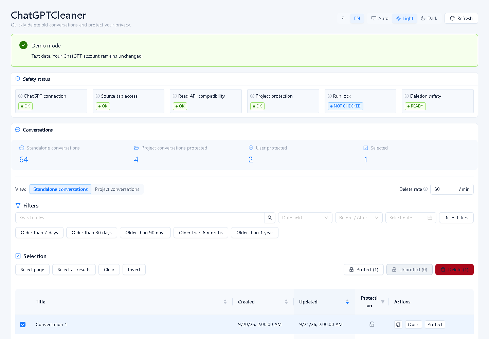
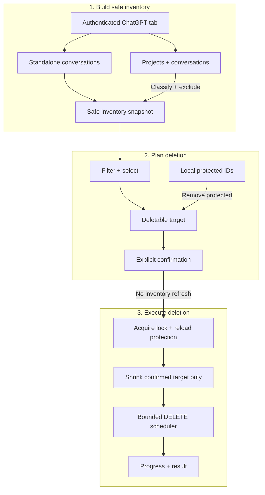

# ChatGPTCleaner

ChatGPTCleaner is an unofficial Chrome Manifest V3 extension for reviewing and bulk-deleting selected standalone ChatGPT conversations while deliberately excluding Project conversations and locally protected chats from deletion.

I created it because manually managing a ChatGPT history of more than 1,500 conversations had become impractical. The manager is designed to make large histories practical to work with through fast filtering, sorting, pagination, selection, and bulk actions.



## What it does

- Loads standalone conversations into a paginated table with filtering, sorting, and explicit selection.
- Discovers Projects, enumerates their conversations, and presents them in a separate read-only view. Project conversations are excluded from deletion.
- Stores locally protected standalone conversation IDs. Protection does not prevent selection; Delete reduces the selected set to its eligible, unprotected subset.
- Deletes confirmed conversations with configurable attempt-start rate and bounded concurrency, retry handling, progress, and Pause, Resume, and Stop controls.

## Safety model

- Before destructive confirmation, ChatGPTCleaner loads standalone conversations, fully discovers Projects, and enumerates their conversations. A new safety inventory is accepted only when those reads complete successfully.
- Project membership is resolved while building the safety inventory. If a conversation appears in both sources, Project membership takes precedence and the conversation is excluded from destructive planning.
- The selected set is validated against the accepted inventory and current local protection state to derive the deletable target. Deletion requires explicit confirmation.
- After confirmation, there are no standalone or Project inventory reads. The manager acquires an exclusive Web Lock, reloads and validates local protected IDs while holding that lock, and removes newly protected conversations from the confirmed target. The target can shrink but cannot expand; Resume and Retry remain subsets of the same confirmed set.
- DELETE attempts use one bounded scheduler. The configured start rate applies to initial attempts and retries, concurrency defaults to one, and only retryable failures use bounded retry handling.

Closing or reloading the manager prevents new DELETE attempts from starting, although a request already sent to ChatGPT may still complete.

## Installation

1. Download the latest `ChatGPTCleaner-vX.Y.Z-chrome.zip` from [GitHub Releases](https://github.com/BinaryWorlds/ChatGPTCleaner/releases/latest).
2. Extract it to a permanent directory.
3. Open `chrome://extensions`.
4. Enable **Developer mode**.
5. Click **Load unpacked**.
6. Select the extracted directory that directly contains `manifest.json`.

Keep the extracted directory available: Chrome loads the unpacked extension from that location.

## Updating

Unpacked extensions installed this way do **not** automatically update from GitHub.

Download the newest release ZIP, replace the files in the existing extension directory, then open `chrome://extensions` and press **Reload** for ChatGPTCleaner.

### Verify a release

After downloading a release, verify its GitHub build provenance:

```bash
gh attestation verify ChatGPTCleaner-vX.Y.Z-chrome.zip -R BinaryWorlds/ChatGPTCleaner
```

## Usage

1. Open `https://chatgpt.com`, sign in, and keep that authenticated tab open.
2. With the ChatGPT tab active, click the ChatGPTCleaner toolbar button.
3. Wait for standalone and Project inventory loading to finish.
4. Optionally protect standalone conversations that should be retained.
5. Filter and select standalone conversations.
6. Review the selection and eligible deletion count, then confirm and start deletion.

Protected standalone conversations may remain selected, but Delete skips them. Refresh before confirming if Project membership may have changed, and do not switch the relevant ChatGPT account or workspace during a run.

## How it works



The inventory is established before confirmation. After confirmation, only local protection state is reloaded, and it can only reduce the confirmed target.

## Privacy

ChatGPTCleaner has no backend, analytics, telemetry, or remote logging. It uses the authenticated `chatgpt.com` tab from which the extension was launched to communicate with ChatGPT. Authentication credentials are not persisted in Chrome extension storage or logged by the extension.

Chrome extension storage contains protected conversation IDs, deletion-rate and maximum-concurrency preferences, and the theme preference. Conversation and Project inventories, confirmed deletion plans, deletion queues, and run history are not persisted.

See [PRIVACY.md](PRIVACY.md) for details.

## Disclaimer

ChatGPTCleaner is an unofficial source-available project and is not affiliated with or endorsed by OpenAI. It relies on internal ChatGPT interfaces that may change. Deletion is destructive and may be irreversible; review your selection and eligible deletion count before confirming and use the extension at your own risk.

## Development

Requirements: Node.js 24, pnpm, and Chrome 120 or newer.

```bash
pnpm install
pnpm dev
pnpm check
pnpm build
```

`pnpm dev:demo` and `pnpm build:demo` use fake infrastructure and do not access ChatGPT. `pnpm build:debug` creates a debug build with source maps. The production `pnpm build` does not emit source maps.

## Changelog

See [CHANGELOG.md](CHANGELOG.md).

## License

The ChatGPTCleaner source is publicly available for transparency and security
review. ChatGPTCleaner is source-available, not open source. Redistribution,
unofficial builds, and derivative products are restricted by the
[ChatGPTCleaner Source License 1.0](LICENSE). Official, unmodified builds are
governed by the [EULA](EULA.md). See [CONTRIBUTING.md](CONTRIBUTING.md) for the
current contribution policy.
