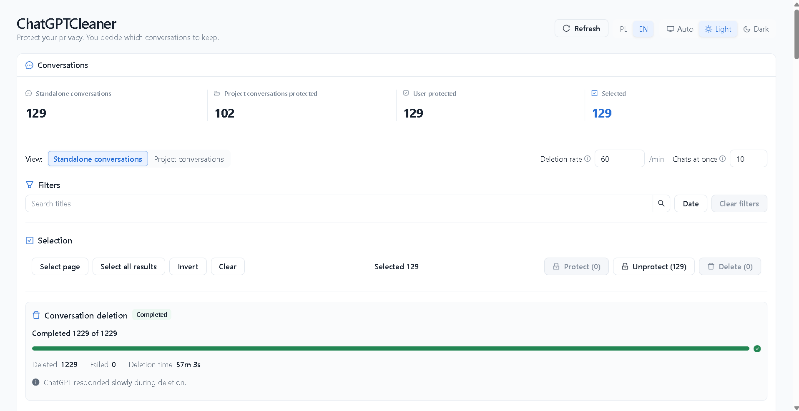

# ChatGPTCleaner

**Protect your privacy. You decide which conversations to keep.**

Find the chats that matter without working through a long ChatGPT sidebar.
Browse your loaded history in one searchable view, protect conversations you
want to keep, and delete selected chats in bulk.

An unofficial Chrome extension for ChatGPT. Load the list once, then search,
filter, and sort locally; refresh when you need an updated list.

**[Download for Chrome](https://github.com/BinaryWorlds/ChatGPTCleaner/releases/latest)**
· [Release notes](CHANGELOG.md)

Choose the release asset named `ChatGPTCleaner-vX.Y.Z-chrome.zip`, not GitHub's
**Source code** archives.


## Features

- **Find what you need:** search titles, filter by date, sort, and select chats
  from the loaded list.
- **Keep important chats:** mark conversations as protected. Project conversations
  are excluded from deletion.
- **Delete in bulk:** review and confirm the selected, eligible conversations,
  then follow progress and results.
- **Choose the pace:** adjust deletion rate and how many chats are handled at once.
  Pause, resume, stop, or retry failed items.

### A completed cleanup

**1,229 conversations processed. 0 failed items.**



Result from one recorded run. Duration varies with settings and ChatGPT response
times.

## Installation

Requires **Chrome 120 or newer**.

1. Download the extension ZIP using the link above.
2. Extract it to a permanent folder.
3. Open `chrome://extensions` and enable **Developer mode**.
4. Click **Load unpacked** and select the folder containing `manifest.json`.

Keep that folder available: Chrome loads the extension from it.

## Usage

1. Sign in at `https://chatgpt.com`. With that tab active, click the ChatGPTCleaner
   toolbar button and keep the source tab open.
2. Wait for conversation and Project loading to finish.
3. Protect chats you want to keep, then filter and select conversations to delete.
4. Review the eligible deletion count and confirm.

**Deletion rate** controls how often attempts start, including retries.
**Chats at once** limits simultaneous operations; the rate setting still controls
when they start.

**Pause** lets you resume the queue. **Stop** ends it after already-started
operations finish. Started operations may also finish after Pause or closing the
manager. Closing or reloading the manager does not automatically resume the queue.

> **Deletion is permanent.** Review the confirmation carefully. Project and locally
> protected conversations are excluded, even if selected. Use **Refresh** before
> confirming if Project membership may have changed, and do not switch the source
> tab's ChatGPT account or workspace during a run.

## How it works


ChatGPTCleaner builds a deletion plan from the successfully loaded conversation
and Project lists. It excludes Project conversations and locally protected IDs.
Start, Resume, and Retry recheck local protection; they cannot add conversations
to the confirmed set. Results update the local list without an automatic refresh.

## Updating

Unpacked extensions **do not update automatically**. Download the latest extension
ZIP, replace the files in the existing extension folder, then click **Reload** for
ChatGPTCleaner at `chrome://extensions`.

<details>
<summary>Optional: verify the downloaded release</summary>

With GitHub CLI installed, verify the ZIP's build provenance:

```bash
gh attestation verify ChatGPTCleaner-vX.Y.Z-chrome.zip -R BinaryWorlds/ChatGPTCleaner
```

Replace `vX.Y.Z` with the downloaded version.

</details>

## Privacy

ChatGPTCleaner has no backend, analytics, telemetry, or remote logging. It uses
the authenticated ChatGPT tab from which it was launched; authentication
credentials are not saved in extension storage or logged by the extension.

Protected conversation **IDs** and preferences are stored locally in Chrome
extension storage. Loaded conversation lists, deletion plans, queues, and run
history are not persisted. Protection is not a backup of conversation content.
See [PRIVACY.md](PRIVACY.md).

ChatGPTCleaner is not affiliated with or endorsed by OpenAI. It depends on internal
ChatGPT interfaces that may change.

## Development

Requires **Node.js 24** and the pnpm version specified in `package.json`.

```bash
pnpm install
pnpm dev
pnpm check
```

For a demo with fake data, use `pnpm dev:demo`. See the
[contribution guide](CONTRIBUTING.md), [product specification](docs/PROJECT_SPEC.md),
and [architecture decisions](docs/adr/) for further details.

## License

ChatGPTCleaner is **source-available, not open source**. The
[ChatGPTCleaner Source License 1.0](LICENSE) governs the source; the [EULA](EULA.md)
governs official, unmodified builds. See the [contribution policy](CONTRIBUTING.md)
before submitting changes.
